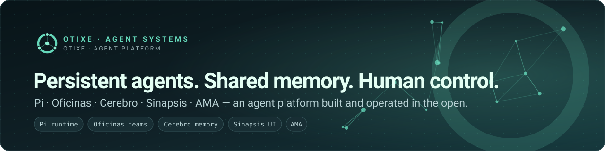

  

  
  
  

<a href="#english">English</a> · <a href="#español">Español</a>

## English

I design and operate **teams of AI agents**: a runtime, persistent roles, shared memory and a human control surface, built as one system and run every day. This profile is the map.

### The problem

A single agent runs out of context, forgets what it decided, and ends up grading its own work. A fleet of agents without coordination duplicates effort and overwrites itself. Both are expensive, and neither is accountable.

### The answer: four components and one integration layer

  

| Component | What it is | Where |
| :-- | :-- | :-- |
| **Pi** | The extensible agent runtime: models, tools, sessions, terminal. | [Fork](https://github.com/otixe/pi) of the [upstream project](https://github.com/earendil-works/pi) |
| **Oficinas** | Persistent, role-scoped teams: own identity and inbox per role, bounded delegation, an author who is not the reviewer. | [`pi-oficinas`](https://github.com/otixe/pi-oficinas) · 6 npm packages |
| **Cerebro** | Shared memory *and* work state: hybrid search, tasks, skills, documents, correspondence, per-agent permissions. | Public repository in preparation |
| **Sinapsis** | The web counterpart of the terminal: see, coordinate and approve what the team is doing. | Public release in preparation |
| **AMA** | *Agent Memory Access* — how the runtime reaches Cerebro (below). | [`@otixe/pi-cerebro-ama`](https://www.npmjs.com/package/@otixe/pi-cerebro-ama) |

### AMA: the evolution of MCP for large tool catalogs

Classic [MCP](https://modelcontextprotocol.io) loads **every tool definition** into the model's context and has it call tools one by one. That is fine for five tools and wasteful for fifty. The newer pattern — popularised by Cloudflare's [Code Mode](https://blog.cloudflare.com/code-mode/) and explored by Anthropic in [code execution with MCP](https://www.anthropic.com/engineering/code-execution-with-mcp) — lets the agent **write a short program against a typed API** instead: a small, stable set of direct tools, the long tail reached through a sandbox, only results flowing back through the model.

AMA applies that pattern to Cerebro, inside Pi, with permissions kept intact: per-agent keys, server-side RBAC, a leader profile and a subagent profile. Its one hard rule — keep the direct tool set stable so the provider's prompt cache is not invalidated — is part of the design, not an afterthought. Quantified results will be published after a representative measurement; until then, [the manual](https://github.com/otixe/plataforma) explains the principle and how to measure your own workload.

### How the work gets done

- **Separation of powers.** Whoever builds does not approve. Independent QA signs off with evidence.
- **Proportionate gates.** Heavy review where the blast radius is large, light where it is not.
- **Memory as continuity.** Decisions, checkpoints and lessons live in Cerebro, so a restarted agent resumes instead of starting over.
- **Security by construction.** Scoped keys per agent, read-only by default for external systems, no secrets in repositories.

### Also here

Companion tools, each documented with the same rigour and honest about its limits:

| Area | Repositories |
| :-- | :-- |
| **Agent engineering** | [`agent-harness`](https://github.com/otixe/agent-harness) · [`bedrock-claude-starter`](https://github.com/otixe/bedrock-claude-starter) · [`obsidian-livesync-agent`](https://github.com/otixe/obsidian-livesync-agent) |
| **Security & MCP** | [`fortigate-policy-auditor`](https://github.com/otixe/fortigate-policy-auditor) · [`mcp-fortigate`](https://github.com/otixe/mcp-fortigate) |
| **Infrastructure** | [`aws-ssm-toolkit`](https://github.com/otixe/aws-ssm-toolkit) · [`terraform-aws-workspaces`](https://github.com/otixe/terraform-aws-workspaces) · [`proxmox-homelab-iac`](https://github.com/otixe/proxmox-homelab-iac) |

Also forked: [`hermes-agent`](https://github.com/otixe/hermes-agent).

### Start here

1. Read the [platform manual](https://github.com/otixe/plataforma) (English and Spanish).
2. Try [`pi-oficinas`](https://github.com/otixe/pi-oficinas): one overloaded session becomes a persistent team.
3. Open an issue on any repository — that is the way to reach me.

Everything here is MIT-licensed. Where a component is not public yet, this page says so.

---

## Español

Diseño y opero **equipos de agentes de IA**: runtime, roles persistentes, memoria compartida y una superficie de control humana, construidos como un solo sistema y usados todos los días. Este perfil es el mapa.

### El problema

Un agente solo agota su contexto, olvida lo que decidió y termina corrigiendo su propio trabajo. Una flota sin coordinación repite esfuerzo y se pisa. Ambas cosas son caras y ninguna rinde cuentas.

### La respuesta: cuatro componentes y una capa de integración

| Componente | Qué es | Dónde |
| :-- | :-- | :-- |
| **Pi** | El runtime extensible de agentes: modelos, tools, sesiones, terminal. | [Fork](https://github.com/otixe/pi) del [proyecto original](https://github.com/earendil-works/pi) |
| **Oficinas** | Equipos persistentes con roles: identidad y bandeja propias, delegación acotada, quien construye no revisa. | [`pi-oficinas`](https://github.com/otixe/pi-oficinas) · 6 paquetes npm |
| **Cerebro** | Memoria compartida **y** estado de trabajo: búsqueda híbrida, tareas, skills, documentos, correspondencia, permisos por agente. | Repositorio público en preparación |
| **Sinapsis** | La contraparte web de la terminal: ver, coordinar y aprobar lo que hace el equipo. | Publicación en preparación |
| **AMA** | *Agent Memory Access*: cómo el runtime llega a Cerebro. | [`@otixe/pi-cerebro-ama`](https://www.npmjs.com/package/@otixe/pi-cerebro-ama) |

### AMA: la evolución del MCP para catálogos grandes

El [MCP](https://modelcontextprotocol.io) clásico carga **la definición de cada tool** en el contexto del modelo y lo hace llamarlas una por una. Con cinco tools está bien; con cincuenta es un desperdicio. El patrón nuevo —difundido por el [Code Mode](https://blog.cloudflare.com/code-mode/) de Cloudflare y explorado por Anthropic en [code execution with MCP](https://www.anthropic.com/engineering/code-execution-with-mcp)— hace que el agente **escriba un programa corto contra una API tipada**: pocas tools directas y estables, el resto detrás de un sandbox, y al modelo sólo vuelven los resultados.

AMA aplica ese patrón a Cerebro dentro de Pi, sin aflojar permisos: keys por agente, RBAC en el servidor, perfil líder y perfil subagente. Su regla dura —mantener estable el conjunto directo para no invalidar la caché de prompt del proveedor— es parte del diseño. Los resultados cuantificados se publicarán tras una medición representativa; mientras tanto [el manual](https://github.com/otixe/plataforma) explica el principio y cómo medir tu propia carga.

### Cómo se trabaja

- **Separación de poderes.** Quien construye no aprueba. La QA independiente firma con evidencia.
- **Gates proporcionales.** Revisión pesada donde el radio de impacto es grande, liviana donde no.
- **Memoria como continuidad.** Decisiones, checkpoints y lecciones viven en Cerebro: un agente reiniciado retoma, no empieza de cero.
- **Seguridad por construcción.** Keys acotadas por agente, sólo lectura por defecto hacia sistemas externos, ningún secreto en repositorios.

### Por dónde empezar

1. Leé el [manual de la plataforma](https://github.com/otixe/plataforma) (inglés y español).
2. Probá [`pi-oficinas`](https://github.com/otixe/pi-oficinas): una sesión sobrecargada se convierte en un equipo persistente.
3. Abrí un issue en cualquier repositorio: es la vía para contactarme.

Todo es MIT. Donde un componente todavía no es público, esta página lo dice.
